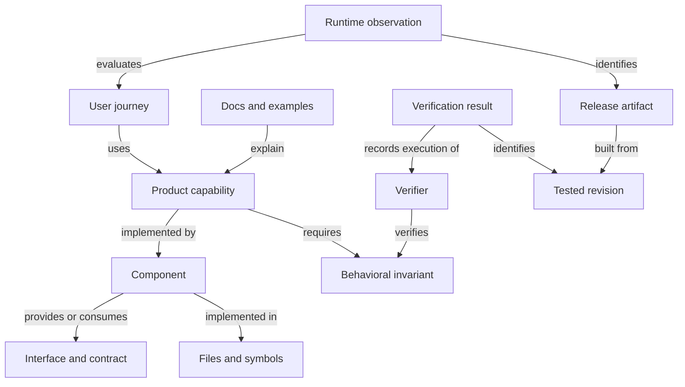

# Project graph and agentic development proposal

Status: repository tooling implemented; the [development loop](development.md) documents current CI acceptance and execution evidence. The [local tool](../tools/project_graph/README.md)
provides deterministic compilation, context/impact queries, test collection, task
and verification journals, advisory CI aggregation, a human explorer and release
identity receipts. Workflow review is the first detailed journey. Larger matched
agent trials and target-environment rollout/recovery evidence remain pending;
implementation and the navigation diagnostic do not establish productivity or CI
selection safety. Full mandatory CI and existing release approvals remain in force.

Implementation tracking: [issue 46](https://github.com/gibli-labs/typeflux/issues/46).

Typeflux should maintain a versioned project graph connecting product
capabilities and user journeys to components, interfaces, implementation,
documentation, verification, and releases. Agents should retrieve the relevant
parts of that graph when developing a change. Humans should see the same
relationships in capability catalogs, architecture views, journey maps, and PR
impact reports.

The first implementation should cover workflow review across the Python and
TypeScript editions and the console, alongside an evaluation of whether graph
access improves development outcomes. Existing CI remains mandatory while graph
impact and test-selection recommendations run in advisory mode.

## Problem and intended outcomes

Typeflux already has [shared contracts](../contracts/README.md),
[cross-edition CI](../.github/workflows/ci.yml),
[workflow topology](control-plane.md#workflow-topology),
[release evidence](release-policy.md#releases-tags-and-evidence), and a guarded
[auto-fix workflow](auto-fix.md). These assets do not yet provide one queryable
model linking a product outcome to its implementations, consumers, tests,
examples, documentation, and rollout obligations.

The graph should help contributors locate the right code, expose dependencies
that a change might affect, identify verification gaps, and trace a shipped
behavior back to its requirements and evidence. Success means less effort per
accepted change with preserved correctness and maintainability. Graph size,
generated code volume, and agent activity are not success metrics.

Capabilities are the organizing unit: for example, review an execution, resolve
a project, inspect a failed run, or deploy a worker. Components distinguish
libraries, services, applications, and external resources. This accommodates
the SDKs, control planes, CLI, console, and MCP without treating every module
as a deployed service.

## Research and design decisions

Research supports specific mechanisms under particular evaluation conditions.
The capability and journey layer, selective CI, and rollout decisions require
Typeflux-specific evaluation. The implications below are proposed engineering
choices, not outcomes established for this repository.

| Evidence | Finding and scope | Design implication |
| --- | --- | --- |
| [RepoGraph, ICLR 2025](https://arxiv.org/html/2410.14684) | Retrieved code definitions and references improved the evaluated systems' resolution rates by 32.8% on average **relative** to their baselines. The experiments concern repository navigation and repair, not deployment safety. | Extract structural relationships and retrieve relevant subgraphs. Evaluate the added capability and journey mappings separately. |
| [Evaluating AGENTS.md, September 2026 revision](https://arxiv.org/html/2602.11988v3) | Generated context files did not significantly improve task resolution and raised average costs by about 20–23%. Developer-written files outperformed generated ones, but their improvement over no context was not statistically significant. | Preserve essential project-specific rules; measure task-specific retrieval against normal search. Do not automatically inject a full repository overview. Brevity alone is not an established remedy. |
| [SWE-agent](https://arxiv.org/abs/2405.15793) | Agent interfaces for navigation, editing, and testing affected software-engineering performance. | Treat query ergonomics, bounded output, errors, and test feedback as evaluated features. |
| [Agentless](https://arxiv.org/abs/2407.01489) | A constrained localization, repair, and validation pipeline was competitive with more complex systems in its benchmark setting. | Start with an explicit workflow and bounded agent steps. Add complexity to address measured failures. |
| [Anthropic long-running agent report, November 2025](https://www.anthropic.com/research/effective-harnesses-for-long-running-agents) | Engineering experiments benefited from structured progress artifacts, incremental changes, and end-to-end verification across sessions. | Persist execution state and evidence outside conversation history. |
| [Anthropic application harness report, March 2026](https://www.anthropic.com/research/harness-design-long-running-apps) | Separate evaluators helped some complex application builds; their value and orchestration overhead changed with task and model capability. This is an engineering case study. | Calibrate independent review and use it where risk or measured benefit warrants it. |
| [Scaling agent systems](https://arxiv.org/html/2512.08296) | Benefits from multiple agents depended on task structure; coordination and error propagation could offset benefits. The study spans several agent domains. | Begin with one implementation agent and explicit verification. Evaluate parallel work on genuinely independent scopes. |
| [Tau-bench](https://arxiv.org/abs/2406.12045) | Evaluates final application state and reliability across repeated trials in interactive tool-use tasks. | Translate journey outcomes into executable assertions and measure repeated reliability. This is a transfer of evaluation methodology. |
| [SlopCodeBench, May 2026 revision](https://arxiv.org/html/2603.24755v2) | This preprint found structural erosion and redundant code across successive extensions of agents' own implementations. Individual passing checkpoints did not establish extensibility. | Measure successive-change quality and enforce explicit architecture boundaries. |
| [AgentDojo](https://arxiv.org/abs/2406.13352) | Tool-returned untrusted content can redirect agents in non-coding environments. | Treat repository and issue text as data; enforce permissions and required verification outside that text. |
| [OpenAI harness engineering report](https://openai.com/index/harness-engineering/) | One internal project's approach used repository-local knowledge, progressive disclosure, mechanical architecture checks, and inspectable application behavior. | Adopt and evaluate these mechanisms. Its productivity estimate and merge policy are not guarantees for Typeflux. |

## Model and sources of truth

Keep four record types distinct, connected by stable identifiers:

| Record | Contents | Update rule |
| --- | --- | --- |
| Project graph | Capabilities, journeys, components, interfaces, code relationships, docs, examples, and declared verification | Reviewed declarations plus reproducible extraction at a repository revision |
| Task record | Intent, acceptance criteria, expected scope, decisions, progress, and recovery state | Versioned updates tied to a particular task and implementation revision |
| Verification record | Verifier identity, inputs, environment, tested revision, result, and evidence artifacts | Append-only results; invalidate applicability when relevant inputs change |
| Policy | Required checks, permission boundaries, escalation conditions, and release obligations | Maintainer-reviewed changes; a proposed change cannot weaken its own gate |

The product graph describes software and intended behavior. Typeflux's existing
workflow topology describes an application's execution shape. Link the two by
explicit identifiers and revisions; do not overload the execution topology or
workflow spec digest with development-process state.



Use typed edges with explicit direction and permitted endpoint kinds:
`implements`, `provides`, `consumes`, `depends_on`, `verifies`, `documents`,
`exemplifies`, and `ships`. Edge types determine impact traversal. A docs link
does not propagate implementation impact like an API consumer edge. The whole
project graph may contain cycles; detect forbidden cycles only in constrained
dependency layers and make traversal cycle-safe.

| Information | Authoritative source |
| --- | --- |
| Purpose, capabilities, invariants, journey semantics, architectural decisions | Reviewed descriptors and linked design records |
| Package dependencies, versions, release units | Package manifests, lockfiles, release workflows, and release policy |
| HTTP surface and schemas | [Normative OpenAPI](../contracts/controlplane/openapi.v1.json) and shared contracts |
| Files, symbols, imports, references | Repository contents and language indexers |
| Review ownership | [CODEOWNERS](../.github/CODEOWNERS) |
| Test identities and results | Test collection, CI reports, and evidence artifacts |
| Deployed and published artifacts | Artifact digests and deployment/release receipts |

Do not maintain second copies of OpenAPI schemas, dependency versions, or
ownership lists. Capability membership can be many-to-many; file-to-component
mapping should have an explicit primary assignment and reviewed shared-file
exceptions. Unmapped files remain visible as unknown rather than disappearing
from impact calculations. Edition support must distinguish shared, partial,
unsupported, and deliberately different behavior, consistent with
[Editions](editions.md).

Each generated relationship records its source location, repository revision,
extractor version, and evidence class: declared, extracted, observed, or
suggested. LLM suggestions remain advisory until reviewed. References to code
use paths and qualified symbols with locations at the indexed revision;
capability IDs survive file renames. Deleted entities retain identity in older
snapshots, and intentional identity changes use explicit migration mappings.

## Representation and queries

Start with YAML declarations validated by JSON Schema and compile deterministic
JSON snapshots. Use a local SQLite index if queries need it. A graph database
and hosted explorer are later options, contingent on need.

Proposed layout:

```text
project-graph/
  schema/
  components/
  capabilities/
  journeys/
  checks.yaml
  policy.yaml
tools/project_graph/
```

The snapshot records repository commit, schema version, extractor version,
input digests, and graph content digest. Hash canonical, sorted content; keep
generation timestamps outside the deterministic content hash. Publish snapshots
as build artifacts and rebuild local indexes from source rather than committing
a large generated graph. Label snapshots from dirty workspaces and prevent
their use as release evidence.

Illustrative capability descriptor; this is a proposed development-tool format,
not a change to the runtime `typeflux.yaml` contract:

```yaml
apiVersion: typeflux.dev/graph/v1alpha1
kind: Capability
id: capability.workflow-review
description: Submit a valid decision for a paused workflow execution.
components:
  - component.python-lifecycle
  - component.python-controlplane
  - component.typescript-controlplane
  - component.console
interfaces:
  - api.controlplane.review
implementation:
  - packages/python/src/typeflux/lifecycle.py
  - packages/python/src/typeflux/project/operations.py
  - packages/typescript/temporal-controlplane/src/operations.ts
documentation:
  - docs/control-plane.md
  - docs/control-plane-auth.md
journeys:
  - journey.review-workflow
invariants:
  - id: invariant.review-permission
    description: The caller has permission to review.
  - id: invariant.execution-binding
    description: The decision targets the correct project and workflow version.
requiredChecks:
  - check.review-authorization
  - check.review-execution-binding
  - check.controlplane-conformance
```

Referenced entities and check IDs resolve through other descriptors and a
validated check registry. The API entity binds its stable logical ID to the
current contract's operations and route variants. The check registry maps IDs
to collected tests and approved CI jobs, with dependencies and environment
requirements. Arbitrary shell text in a descriptor is not executable policy.

Validate unique IDs, references, schema versions, source locations, nonempty
path selectors, collected test IDs, ownership resolution, and allowed edge
types. Parse repository content without importing application modules during
indexing. Any extraction requiring execution uses an isolated, unprivileged
environment. Add deeper symbols through language tooling, evaluating formats
such as [SCIP](https://github.com/scip-code/scip) after package/file extraction
works. Dynamic imports, injected transports, and runtime-selected behavior need
explicit mappings or an unknown result.

Proposed commands:

```text
project-graph context capability.workflow-review --revision <sha>
project-graph impact --base <sha> --head <sha>
project-graph explain <source-id> <affected-id> --revision <sha>
project-graph checks --change-set <id>
project-graph verify --change-set <id>
```

Context responses contain purpose, invariants, relevant implementation,
interfaces, examples, decisions, checks, and known gaps. Bound initial output,
explain inclusion paths, and permit expansion. Keep normal repository search
available when the graph is incomplete. Expose the same query implementation
through MCP later; do not introduce different impact rules for different tools.

## Development workflow and recovery

1. Associate the task with capabilities, journeys, acceptance criteria, and
   compatibility obligations. New functionality proposes new graph entities.
2. Assemble context at the task's base revision and record the tool/model
   configuration. Separate retrieved facts from executable policy.
3. Implement a bounded change and update affected declarations, tests, docs,
   and examples. Reconcile declared scope with the observed diff.
4. Validate with the approved check registry. Record the exact tested revision
   or tree digest, environment, output, result, and artifact references.
5. Produce a PR report with impact explanations, gaps, behavioral changes,
   edition parity, evidence, and release requirements.
6. Bind accepted results to the merged/integration revision and exact release
   artifact. Promotion uses the existing permission and release policy.

Task state progresses through planned, implementing, validating, review-ready,
and accepted, with explicit blocked or failed states. A no-progress limit,
bounded repair attempts, resource budget, and escalation condition prevent
indefinite retry. Infrastructure retries must not silently reclassify a product
failure as success.

Persist base/head revisions, intended scope, decisions, outstanding work, and
evidence references. On resume, verify the worktree and revalidate inputs before
reusing results. Side effects such as PR creation or promotion need idempotency
keys and reconciliation after ambiguous failures. Store sanitized command/tool
events and observable outputs; do not require private model reasoning in the
audit trail.

Extend the [existing auto-fix lane](auto-fix.md) without relaxing its label,
protected-path, environment-approval, or complete-before-PR requirements.
Start with one implementation agent. Add independent review or parallel work
only when task boundaries and evaluation justify the overhead. Keep conflicting
edits isolated and validate the combined revision. Temporal orchestration is a
later option for durable development tasks; the compiler and verifier must
remain usable directly from local tools and CI.

## Verification and CI

A declared test link means intended coverage. A passed result means a particular
verifier ran successfully against particular inputs. Neither establishes that
an invariant is completely protected. For bugs, capture a reproducer that fails
on the original revision and passes after the change when practical. Supplement
it with existing regression, conformance, replay, and journey verification.

Compute change impact from both base and proposed graphs so removed interfaces,
deleted files, and renames retain their dependency history. Traverse relevant
reverse dependencies to a fixed point using edge-specific rules. Include
build/configuration inputs and shared contracts. The impact report must explain
why each component, journey, and check is included.

| Change | Verification obligations |
| --- | --- |
| Shared API or schema | Both implementations, conformance, generated clients, consumer compatibility, applicable version changes |
| Execution or lifecycle semantics | Replay, expected lifecycle behavior, workflow identity/versioning, drain implications |
| Console interaction | Relevant journey outcomes, permissions, failure states, and recovery |
| Provider behavior | Provider contracts, deterministic fixtures, targeted live checks where required |
| Build, lockfile, policy, unknown mapping, or failed extraction | Broad validation and explicit impact review |

Introduce selection in advisory mode alongside current mandatory CI. Record the
checks that would have been selected and compare them with full-suite outcomes.
Unknown mappings, stale snapshots, extraction failures, and unrecognized
configuration changes expand validation. A graph is an incomplete model of
dependencies; absence of an edge is not proof of independence.

After evaluation supports selective checks, retain a protected baseline and
broad integration/release checks. The aggregate required check must run even
after upstream failures and verify that all planned checks passed. Missing,
cancelled, and unexpectedly skipped checks cannot count as success. GitHub
documents [required-check skipping pitfalls](https://docs.github.com/en/pull-requests/how-tos/merge-and-close-pull-requests/troubleshooting-required-status-checks).
If a merge queue is adopted, add the
[merge_group trigger](https://docs.github.com/en/repositories/configuring-branches-and-merges-in-your-repository/configuring-pull-request-merges/managing-a-merge-queue)
and evaluate the actual integration revision.

Evaluate minimum obligations using trusted base policy. Proposed descriptors
may add obligations but cannot remove them for their own change. Removals need
maintainer review and an explicit policy transition. Tests run on proposed code
in unprivileged environments; publication credentials and approval enforcement
stay outside that environment. Treat issue text, docs, comments, and retrieved
records as untrusted data. Verify downloaded evidence against run/revision and
artifact identity rather than trusting an agent-authored success flag.

Protect acceptance criteria from unreviewed weakening. Agent-generated tests
can supplement evidence, while changes to the expected behavior and verifiers
receive review. During pipeline evaluation, use separate held-out tests.
Architectural checks should enforce reviewed dependency directions and boundary
contracts. Track duplication and complexity trends as review signals, not
universal numerical gates that can be gamed by moving code around.

## User journeys and human views

A journey describes a persona and goal, entry surface, preconditions, actions,
state transitions, expected outcomes, and failure/recovery paths. Entry surfaces
include SDK, CLI, API, MCP, and console. Every step links to capabilities,
interfaces, acceptance assertions, and measurements where available.

The first journey is an operator reviewing a paused execution:

| Step | Observable outcome | Important alternative paths |
| --- | --- | --- |
| Open the execution | The addressed project, workflow, and execution are displayed | Missing execution; foreign project; unavailable backend |
| Inspect the gate | Valid decisions for that execution's version are shown | Stale view; unsupported operation; missing permission |
| Submit a decision | The intended execution accepts a permitted decision | Permission denial; invalid decision; binding mismatch; uncertain delivery |
| Confirm progress | The expected lifecycle transition is observed | Timeout; worker unavailable; retry/recovery without an unintended duplicate effect |

Acknowledgement of a submission is distinct from confirmation of execution
progress. Verify both where the journey requires them. Use fake providers and
isolated Temporal fixtures for repeatable tests, with targeted live checks for
behaviors those fixtures cannot establish. Track completion, time to outcome,
failure categories, and recovery success. Unknown telemetry remains unknown;
release-correlated failures are investigation leads, not proof of causation.

Generate four human views from the same graph:

- A capability catalog showing purpose, implementations, edition support,
  ownership, documentation, examples, and verification gaps.
- Architecture views with progressive detail and typed dependencies.
- Journey maps showing outcomes, alternate paths, tests, and observed behavior.
- PR impact reports explaining changed behavior, affected consumers, required
  evidence, unresolved gaps, and rollout obligations.

Each view shows the indexed revision and distinguishes declared, verified,
observed, and unknown information. Start with generated documentation and PR
artifacts. Add an interactive explorer after the data and queries prove useful.

Use the existing [metadata contribution framework](../packages/python/src/typeflux/metadata.py)
for runtime metadata that can be expressed through it, with matching edition
behavior where applicable. Keep journey and step tags low-cardinality; exclude
freeform input, reviewer identity, notes, and secrets. Per-run identifiers and
artifact digests may be evidence references, not search tags. This proposal
does **not** change the workflow execution manifest: UI interactions, PRs, and
development tasks belong in separate linked records unless they actually alter
the workflow execution graph.

## Release and rollout

Bind release evidence to the source/integration revision, graph snapshot,
artifact digest, affected capabilities and journeys, compatibility results,
and rollback procedure. Reuse a result only when its complete relevant inputs
match; passing a branch before integration does not prove the merged artifact.

Model Python, the TypeScript SDK train, generated client, MCP, console, and
worker deployments according to the [release policy](release-policy.md).
Distinguish dependencies on source in the PR from dependencies on published
packages. Consumers pinned to a published client must be evaluated against
that actual dependency, with any release sequence made explicit.

For deployed applications, define environment-specific journey smoke tests,
observation windows, acceptance thresholds, and recovery procedures before
promotion. For SDKs, use installation and consumer-compatibility checks on the
candidate artifacts. Worker changes require replay/version compatibility and
drain handling; reverting an image alone may not safely handle in-flight
workflows. Preserve immutable releases and superseding/yanking/deprecation
procedures. The graph does not authorize migration, termination, publication,
or production access.

## Evaluation plan

Build evaluation with the first graph slice. Start with approximately 30–50
representative tasks across SDK behavior, contracts, console journeys, docs,
and deployment logic, expanding as smaller effects need more observations.
This pilot is diagnostic and does not establish rollout safety by itself.

Reconstruct historical tasks at their original starting revisions, including
graph descriptors created solely from information available at that point.
Do not leak solution patches, future docs, or held-out tests into agent context.
Include prospective tasks, stratify by risk and scope, and keep a separate
holdout when tuning retrieval or prompts.

| Configuration | Question |
| --- | --- |
| Current tools and essential repository rules | What is the baseline? |
| Baseline plus graph queries | Does structural retrieval help? |
| Graph queries plus task-specific context assembly | Does automatic selection improve outcomes or reduce effort? |
| Best configuration plus independent evaluation | Where does an additional evaluator justify its cost? |

Use matched models, versions, budgets, tool access, and environments; repeat
trials and report uncertainty. Record CPU/RAM allocations and ceilings, time
limits, tool versions, and infrastructure failures. Resource configuration can
materially affect agent evaluation results, as shown in
[Anthropic's infrastructure study](https://www.anthropic.com/research/infrastructure-noise).
Include tests for interruption/recovery, stale graphs, deleted mappings,
attempted policy weakening, and instructions embedded in retrieved data.

Measure held-out correctness, regressions, human review/correction time,
elapsed time and cost per accepted change, missed dependencies, irrelevant
context, graph maintenance effort, and repeated success. Evaluate sequences of
changes against an agent's own prior implementation to expose architectural
degradation. Preserve full-suite comparisons to count failures that proposed
test selection would miss.

Productivity must be measured directly. METR's
[early-2025 randomized study](https://metr.org/Early_2025_AI_Experienced_OS_Devs_Study-paper.pdf)
found a 19% slowdown in its experienced-developer setting, despite perceived
speedups. Its [February 2026 update](https://metr.org/blog/2026-02-24-uplift-update/)
identified selection and measurement problems preventing a reliable current
effect estimate. Neither establishes Typeflux's expected speedup or slowdown.

Before expanding autonomy, record the tolerated regression risk, minimum
evidence, and decision owner for the relevant task class. Review thresholds
before examining the holdout results. A small sample with no observed misses
does not establish that graph-based selection is complete.

## Implementation milestones

| Milestone | Deliverable | Exit criteria |
| --- | --- | --- |
| 1. Workflow review and evaluation | Schema, deterministic compiler, component/file/contract extraction, review capability and journey, initial queries, verifiers, and baseline evaluation | Reproducible snapshots; valid references and test IDs; both editions represented honestly; success and failure journey paths verified; retrieval compared with the baseline |
| 2. Agent and PR integration | Versioned task/evidence records, context assembly, impact explanations, and PR reports integrated with existing tooling | Changed files mapped or explicitly unknown; base/head deletions handled; recovery does not reuse stale evidence or repeat external effects; human review effort measured |
| 3. CI integration | Advisory selection, failure classification, aggregate checking, and evaluated guarded selection | Protected baseline retained; unknown inputs broaden checks; full-suite comparisons and adversarial policy tests pass; selection enabled only for approved task classes |
| 4. Journey and release feedback | Human explorer, telemetry links, release evidence, and environment-specific rollout evaluation | A regression can be traced to exact artifacts and candidate changes; recovery/drain procedures verified; promotion remains subject to existing policy |

Implementation PRs should be complete and independently reviewable. Do not
bundle a mandatory CI reduction or production promotion change into the initial
graph implementation. Publish evaluation results, including negative findings,
before deciding whether to expand retrieval, automation, or test selection.

## Alternatives and compatibility

A larger static agent instruction file is inexpensive to produce but must be
tested against evidence that repository overviews may add cost without improving
resolution. Text search remains a baseline and a fallback. A code-only index
helps navigation but cannot express intended product outcomes. A full portal or
graph database adds operational and UI work before the retrieval value is known.
LLM-inferred graphs are useful suggestions but cannot be authoritative CI policy.

The initial tooling is repository-development infrastructure. It changes no
public SDK API, runtime YAML, control-plane contract, workflow manifest, or
release policy. Later public graph/MCP interfaces and runtime instrumentation
require their own compatibility decisions and cross-edition validation.

The maintainer remains the decision owner under [Governance](../GOVERNANCE.md).
Implementation should record unresolved mappings and tradeoffs explicitly;
graph completeness, agent self-assessment, or a passing generated test must not
substitute for the evidence required by the selected task class.
